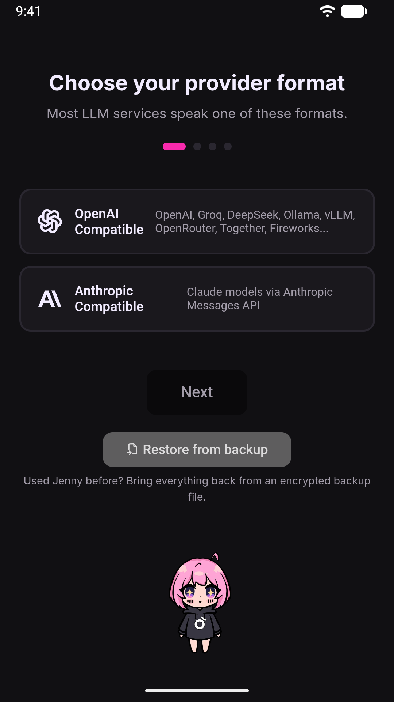
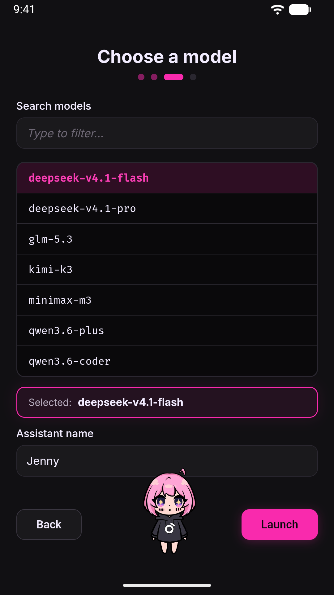

# First run

The first time you open Jenny after installing the APK, you go through a slow boot and then a short setup wizard — this page walks through exactly what happens and what you'll see.

## The first boot is slow, and that's normal

Jenny bundles its own Python 3.11 runtime (via Chaquopy) inside the APK — there's nothing else to install, but on the very first launch that runtime has to be unpacked onto the device before the app can do anything. You'll see a loading screen while this happens. The app polls the local gateway for up to **90 seconds** before giving up, so if the loading screen sits there for a while, it's usually still working, not frozen.

Subsequent launches are fast: the Python runtime is already extracted, and the app only has to start the gateway process.

If the 90-second timeout is reached and the app never connects, see [Troubleshooting](../using/troubleshooting.md).

## What gets created on first launch

Before you see the setup wizard, the app has already:

- Created a workspace folder inside the app's private storage (`<filesDir>/workspace` — not visible to file managers, and not touched by other apps on the phone).
- Written a minimal `config.json` into that workspace, containing a random **per-install secret** (`websocket.token_issue_secret`) used to authenticate the WebUI to the local gateway. This secret never leaves the device: the native app reads it from `config.json` and passes it to the embedded WebView as a URL *fragment* (`#bs=...`), never as a query parameter, so it can't end up in logs or server request lines.
- Extracted the built-in prompt templates, skills, and UI assets from the APK into the workspace.
- Started the gateway itself — **without any LLM provider configured**. The gateway is alive and the WebUI can load, but there's no agent yet: that's exactly the gap the setup wizard fills in.

Nothing about this step requires action from you; it's what happens between tapping the app icon and seeing the wizard.

While this happens Android asks for two permissions, one after the other: first **notifications** (for Jenny's alerts and the "Jenny is running" notification), then **location** — precise or approximate, whichever you prefer. Both can be refused: Jenny works without them, and location can be allowed later from the workshop's **Hands → Location**.

## The setup wizard

Because no provider is configured yet, the app opens a 4-step wizard. It is a page of its own: until a provider exists, both the home and the workshop send you back to it. A row of four progress dots at the top of each step shows how far you are.

### Step 1 — Choose your provider format

Two cards:

| Card | Covers |
|---|---|
| **OpenAI Compatible** | OpenAI, Groq, DeepSeek, Ollama, vLLM, OpenRouter, Together, Fireworks... |
| **Anthropic Compatible** | Claude models via Anthropic Messages API |

Pick whichever matches the service you have an API key for, then tap **Next**. Below the Next button there's a **Restore from backup** button (a `.jbk` file); in the Play Store build Jenny asks **"Have we met before?"** there, with **Yes, find my copy** (her copy on Google Drive, when the phone has Google services) above it — see [Restoring from a backup instead](#restoring-from-a-backup-instead) below.

### Step 2 — Connect your provider

Three fields:

- **Provider name** — a free-form label to identify this provider: it's the name you'll see in Settings. Required.
- **API Key** — required. This is the only thing that authenticates you to the LLM provider; it is stored in `config.json` on the device and is never sent anywhere except to that provider's API.
- **Base URL** — optional. If you leave it empty, Jenny uses the format's default: `https://api.openai.com/v1` for OpenAI Compatible, `https://api.anthropic.com` for Anthropic Compatible. Change this if you're pointing at OpenRouter, Groq, DeepSeek, a self-hosted Ollama/vLLM instance, or any other compatible endpoint — see [Providers and models](../reference/providers.md) and [Local models](../reference/local-models.md) for details. It must be a web address starting with `http://` or `https://`: anything else is refused with a message before the wizard moves on, and a capitalized scheme such as `Http://` is corrected to `http://`.

The Next button only enables once both the provider name and the API key are non-empty. If you come back to this step with **Back**, what you typed is still there and Next is already on.

### Step 3 — Choose a model

This step tries to fetch the live list of models straight from the provider's `/models` endpoint (a 10-second timeout applies) so you can pick from what's actually available rather than typing an ID from memory.

- If the fetch succeeds, you get a searchable list — type in the **Search models** box to filter it. There's no manual field in this case.
- If the fetch fails, the list comes back empty, or the provider doesn't expose a `/models` endpoint, the reason is shown where the list would be, and an **Or type a custom model name** field appears below it so you can enter the model ID by hand.
- This step also has an **Assistant name** field for what you want Jenny to call herself (default "Jenny"). You can change it later in the home's **Settings → Jenny → Her name** (up to 40 characters; changing it erases no memory).

Once a model is selected (from the list or typed manually), the **Launch** button enables. The choice belongs to the provider you entered: if you go back and change the format, the key or the base URL, the model is cleared and you pick it again from the new list.

### Step 4 — Connect Telegram (optional)

After Launch succeeds, a final, skippable step offers to pair a Telegram bot so you can talk to Jenny from Telegram as well as the WebUI. Tap **Skip for now** to finish onboarding without it — you can pair Telegram later at any time, from the workshop's **Hands → Telegram**. If you do pair it here, a *Telegram paired!* toast confirms it and the button becomes **Done**. See [Telegram bridge](../using/telegram.md) for the full pairing flow.

If Android is still optimizing Jenny's battery use, the same step shows a card with **Exempt from battery**: without the exemption, scheduled work, reminders and proactive checks arrive late or not at all while the screen is off. The card disappears once the exemption is granted.

Either button takes you to the home, on Jenny's page, with her welcome message.

## What "Launch" actually does

Pressing **Launch** does the following, in order:

1. **Validates the provider before saving anything.** The backend tries to actually construct a provider from what you entered. If that fails (bad format, missing key, provider rejects the request), you get an error toast on the spot — e.g. `Provider configuration is invalid: ...` — and **nothing is written to config.json**. You stay on the same step and can fix the fields and try again.
2. Only if validation succeeds: writes `providers.providers` (a list with just this provider — see the note below), `providers.default`, `agents.defaults.model`, `agents.defaults.bot_name`, and the current UI language to `agents.defaults.language`.
3. Adds a localized welcome message to the chat — in English: *"Hi, I'm {assistant name} and from today I live on your smartphone. Nice to meet you!"*
4. Signals the gateway to create and start the agent **immediately, with no app restart**. The gateway was already running (just without an agent); it picks up the new configuration and becomes usable right away.

## Interrupting the wizard

- **Before pressing Launch on step 3**: nothing has been persisted yet. The phone's Back button moves one step back (and closes the restore passphrase dialog first, if it's open), but it never leaves the wizard: the only way out is closing the app, and reopening it lands you back at step 1 — you start over from scratch.
- **After Launch, during the optional Telegram step**: the provider, model, and assistant name are already saved and the agent is running. If you close the app here, the next launch goes straight to the home, on Jenny's page (Telegram can still be paired later from the workshop's **Hands → Telegram**).

## Restoring from a backup instead

If you had the Play Store build of Jenny on another phone with the **copy on Google Drive** turned on, tap **Yes, find my copy**: allow Google Drive, type the copy's password — the one you chose when you turned the copy on — pick the copy — the latest is first — and tap **Restart now**. The wizard is skipped after the restart, as below. The details are in [Backup and restore](../using/backup.md#getting-jenny-back-on-a-new-phone).

If you have an encrypted `.jbk` backup file instead, tap **Restore from backup** on step 1 instead of going through the wizard. This opens the same import flow used from the home's **Settings → Backup → Restore from a file**: pick the file via the Android system picker, enter the backup passphrase, and confirm. The restore is staged, not applied immediately — the app then prompts you to restart, and the actual restore happens at that restart, before anything else touches the workspace. Once restored, the app boots straight into the home, on Jenny's page, with your old provider, history, and memory already in place — the wizard is skipped because a provider is already configured. See [Backup and restore](../using/backup.md) for the full mechanics.

## Things to know that aren't obvious

- **The wizard runs once.** It only appears while no provider is configured, and there is no way back to it from the interface afterwards. (Under the hood, saving it writes a provider list with just the provider you entered — which is why there's no "run setup again" button.) Add further providers from the workshop's **Brain → Who thinks → Add provider**.
- **Model-fetch error messages come from the backend in English**, regardless of which UI language you're using — for example "The provider rejected the configured credential." or "Configure an API base URL to load models." They aren't translated.
- **An empty model list is not an error.** If the provider's `/models` endpoint returns zero models (wrong key, wrong base URL, or the provider just doesn't have any), the backend still responds with HTTP 200 and an explanatory message; the wizard shows that message instead of an error banner, and reveals the manual model-ID field.

## What's next

Once onboarding is done, take the [Tour of the WebUI](../using/webui-tour.md) or jump straight into [Chat basics](../using/chat.md). If you want Jenny available from your home screen, see [Set it as your launcher](launcher-setup.md).
