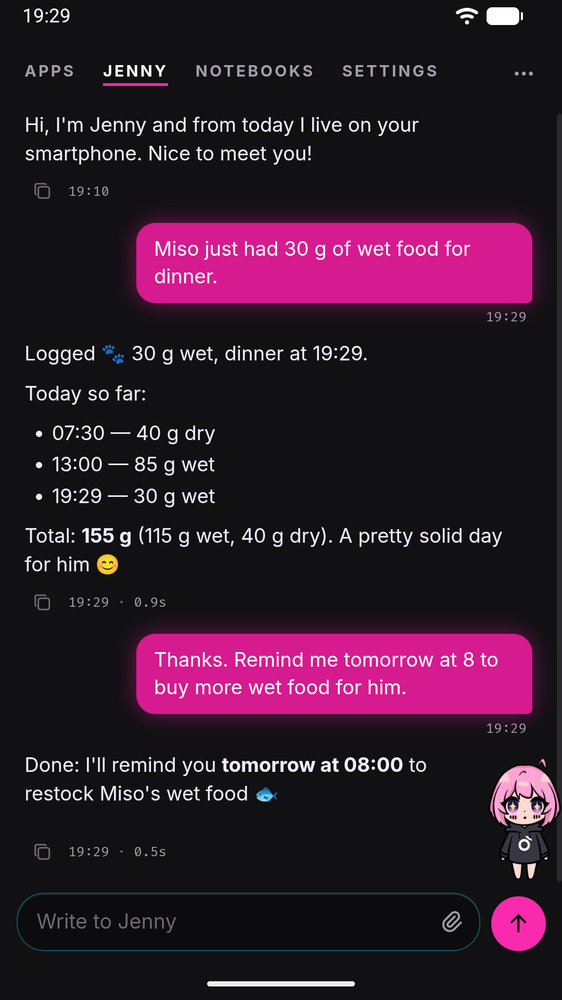

# Introduction

Jenny is a personal AI agent that runs entirely inside an Android app on your own phone, instead of in someone else's cloud.

## What it actually is

Jenny is not a chat client that talks to a hosted service. It is an Android APK with an embedded Python runtime (Chaquopy) that runs a real agent loop, a small HTTP/WebSocket gateway, and a mobile web UI, all on the device itself. When you open the app, the UI you see is served from `127.0.0.1` on the phone and talks to a gateway process that also lives on the phone. There is no Jenny server anywhere — the phone is the whole stack.

That has a few direct consequences worth knowing before you install it:

- **Bring your own key (BYOK).** Jenny does not ship a model. You configure an API key for a provider you already have — Anthropic, OpenAI, OpenRouter, Groq, DeepSeek, or a self-hosted runtime like Ollama or LM Studio — during onboarding. Every request the agent makes to a model goes out with your key, so usage costs are yours, billed directly by your provider. There is no subscription to Jenny itself.
- **One unified personal conversation.** There are no chat threads to manage: everything you say to Jenny — over the web UI or, if you connect it, over Telegram — happens in a single ongoing conversation. Sending `/new` from either channel resets that one conversation for both. The one exception is a [notebook](../using/projects.md): a conversation bound to one folder, which you open from the **Notebooks** page and which keeps its own history and its own memory.
- **Persistent memory.** Jenny keeps a working session history, and periodically runs a background consolidation pass (called Dream) that distills recent conversation into plain Markdown files on disk: who you are, how you like answers, durable project context, and skills it noticed you repeat. This is what lets it remember you across restarts instead of starting cold every time you open the app.
- **Proactivity.** Jenny can act without you asking first: one-time reminders, and recurring jobs that either speak every time or stay quiet until something needs your attention. A foreground service keeps it alive with the screen off, which is what makes any of that possible at all.

Beyond the chat itself, Jenny can read and edit files in its own workspace, run Python, search and fetch the web through a real WebView, track a location if you allow it, and even write small companion apps for itself (Jenny Apps) when you describe what you want in conversation. It can optionally act as your phone's Android launcher, and it can optionally bridge to Telegram so proactive messages reach you even when you're not looking at the phone.

## Prerequisites

Before you install anything, know what you'll need:

| Requirement | Detail |
|---|---|
| Device | An Android phone or tablet running Android 8.0 (API 26) or newer |
| An API key | A paid account with at least one LLM provider (or a self-hosted model reachable from the phone) |
| Budget | Your own — every conversation with a hosted provider consumes your key's quota/billing |
| Install method | Sideloading (building the APK yourself, or installing a release build) — there is no Play Store listing |
| Time | A few minutes for onboarding, plus a first-boot delay while the app extracts its embedded Python runtime |

Jenny does not require an account, a sign-up, or any Jenny-operated service to function — the only external party involved is whichever model provider you choose to pay.

## Where to go next

- New to the project and deciding whether to install it at all: [Is Jenny for you?](is-jenny-for-you.md)
- Ready to install: [Install the APK](install.md)
- Just installed and opening it for the first time: [First run](first-run.md)
- Curious about using it as your Android home screen: [Set it as your launcher](launcher-setup.md)
- Want the full feature tour once it's running: [Tour of the WebUI](../using/webui-tour.md)

## Honest framing

Jenny is a sideloaded app built by one person, not a polished consumer product. It works day to day, but onboarding still has rough edges, some settings can currently only be changed by editing `config.json` directly (see [Configuration](../reference/configuration.md)), and a handful of behaviors fail silently rather than with a clear error — these are called out explicitly throughout this documentation rather than glossed over.
