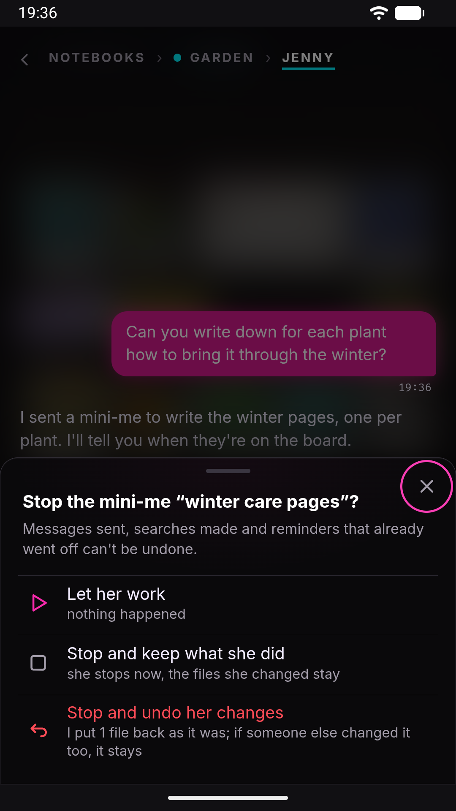

# Helpers: stop, undo, continue

Jenny hands most real work to **helpers**, smaller copies of herself she calls *mini-mes*: one researches, one writes an app, one edits a notebook. While a helper works, the chat stays free for you. This page covers what you see of a helper in the home's chat, and the three things you can do with one: stop it, put back what it changed, and let it continue after an interruption.

Why Jenny delegates at all, the kinds of helper and what each may touch: [Scheduling and proactivity → Subagents](scheduling.md#subagents-spawn).

## What a helper looks like

When Jenny sends a helper, a bubble appears at the bottom of the chat: *I sent a mini-me: plant cards*, with the time it has been working and one line on what it is doing right now (*Reading*, *Searching*, *Writing*, *Running code*…). With two or more at work the bubble lists them, one row each, with a stop icon on every row. If one goes a minute without progress, a line says *She's small but stubborn: this takes a while*. That is a note, not an error: a helper is never cancelled for being slow.

When a helper finishes, a short bubble says *My mini-me is done: plant cards*, and Jenny reads its report and tells you the outcome in her own words.

Press and hold any helper bubble to open the workshop, whose Console shows each helper's full activity, step by step.

## Stopping a helper

Tap **Stop her** on the bubble (or the stop icon on a helper's row). A sheet asks what to do:

- **Let her work**: nothing happens.
- **Stop and keep what she did**: she stops now, and every file she already changed stays as it is.
- **Stop and undo her changes**: she stops, and the files she changed are put back as they were before her. This row appears only when she has changed something.

If you stop and keep, and she had changed files, a bubble remembers it: *You stopped the mini-me: plant cards. What she did is still there: 3 files changed.*, with an **Undo her changes** button. So you can stop first and decide later.

## What undo puts back

Every file a helper writes is noted as it writes it: the content before her first change, and what she left. Undo uses that note, and it is careful:

- **A file goes back only if it is still exactly as she left it.** If you, Jenny or another helper changed it afterwards, it stays as it is now. The result says so: *1 left as they are, because someone else changed them too: Watering.md*.
- **A notebook's board and reminders are undone card by card.** Her changes to one card go back, and a card someone else touched since stays.
- **It covers her whole run**, including the parts she did after being continued.

Some things are not files, and those can't be undone. The sheet warns you: *Messages sent, searches made and reminders that already went off can't be undone.* Neither can scheduled jobs she created. Changes waiting as [drafts](scheduling.md#changes-waiting-for-your-approval) need no undo: they were never written, and you can still discard them.

A file larger than 5 MB isn't saved before her change, so it can't be put back. The same goes for files after the first 200 MB a helper changes, or past 2,000 files in one folder. The result lists any file it left alone and why.

When it is done, a line tells you: *Undone: 3 files put back as they were before her.*

### Undoing later, and asking Jenny

The undo button appears on helpers that stopped before the end: stopped by you, stuck, or out of breath. A helper that finished normally has no button. If you don't like what it did, tell Jenny (*undo what the mini-me did to the plant cards*). She can undo any finished helper the same way, with the same care, and she tells you what she put back.

Undo stays possible as long as the helper's record is kept: the last 20 helpers per chat, for 7 days. An undone helper can't be continued afterwards.

## When a helper is interrupted

A helper can stop without anyone deciding it. Its bubble then says what happened, and most of the time offers **Let her continue**:

- **The app restarted under her**: Android killed the app, the phone rebooted, or you closed Jenny. *My mini-me was interrupted*. What she did is saved, and she picks up from there.
- **The model stopped answering for a while**: the provider was rate-limited, down or timed out. *My mini-me got stuck*.
- **She ran out of breath before the end**: she used up the steps one job is allowed.

**Let her continue** gives her back her own conversation, everything she read and wrote, and asks her to finish the job and report what is done and what remains. She does not start over. A few limits apply:

- After a restart she resumes from the last saved point, taken at most every 30 seconds while she works. A step done after that point is done again.
- Her saved conversation is kept for 6 hours. Past that, or once it has grown very long, she can't be continued.
- A helper that writes an app can't be continued after a restart. Ask Jenny again instead.
- Inside a [plan](plans.md), the plan resumes its own helpers. You don't need to press anything.

Any other failure offers **Get her back up**, which starts the job again from the beginning.

## `/stop` and helpers

`/stop` ends Jenny's current reply but leaves helpers working, and says so: *A mini-me keeps working in the background: stop her from her own bubble, or with /stop all.* `/stop all` also stops every helper of that chat. It does not undo anything: a helper stopped that way that had changed files shows the *You stopped the mini-me* bubble, with its undo button. See [Slash commands](slash-commands.md).

## Limits

- Up to **3** helpers at a time by default, with one place kept for a quick job, so a normal job waits for a free place once two are running (`agents.defaults.maxConcurrentSubagents`). A plan step can use more.
- A helper that makes no progress for 3 minutes is flagged as stuck, never cancelled for you.
- Jenny relaunches a failed helper on her own at most three times.

## See also

- [Scheduling and proactivity → Subagents](scheduling.md#subagents-spawn): kinds of helper, drafts waiting for approval, steering from the workshop.
- [Plans](plans.md): helpers working one step at a time, with a photo of the notebook before each step.
- [Security model](../internals/security-model.md#subagents-and-untrusted-content): what a helper that read the web may and may not change.
