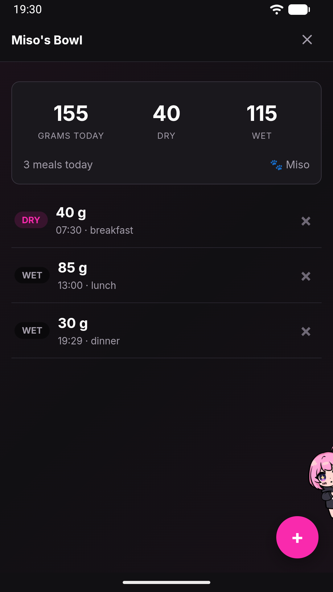

# Mini-apps (Jenny Apps)

A Jenny App is a small app that Jenny builds for you on request — a shopping list, a portfolio you update, a reading from a device on your network. An app is always **general**: it lives in the **App** page, and you can also put it on a notebook's board as a card of its own, where its live value takes the place of the photo and a tap opens it.

Every part of an app is optional:

- a **screen** you open and use — a list you check off, a form you fill in;
- **actions**, which Jenny can call as tools;
- a **reader**, a small program that reads something by itself every few minutes (a sensor, a price) or recomputes a total from the app's own data, with no model involved;
- a **summary**: how the app shows outside its screen — on its card on a board, in place of the photo — as one value, a few values side by side, a progress bar, a list or a small table.

## Apps vs. skills

Jenny has two ways of gaining a new capability, and they answer different questions:

- **If it needs a screen, a live value or a place on a board, it's an app.** A Jenny App has its own UI you open from the App page (see [Phone app launcher](app-launcher.md)) — a list you check off, a form you fill in — or a value that keeps itself fresh, or both.
- **If it only lives in chat, it's a skill.** A skill just teaches Jenny a procedure — there's nothing to open. See [Skills](skills.md).

An app can still talk to Jenny (see [Directionality](#jenny-and-the-app-talk-in-one-direction) below), and it can integrate with an external server, but the defining trait is: does the user need to look at a screen for this, or does it just happen in conversation?

## Creating an app

Apps are created only through chat — there is no app editor or "new app" button. Just ask, in your own words, in the personal chat or in a notebook's chat: "make me an app for tracking my plants", "I want to note my ETF purchases and see what the portfolio is worth".

Jenny walks you through the design conversation (what the app tracks, what actions it needs) using the built-in `app-creator` skill, confirms with you, and writes it with her `app` tool. Whenever the app keeps something — a reader, or data it writes — Jenny also decides its summary by herself: you are never asked "do you want a widget?".

### An app exists only once it works

Jenny checks an app before saving it: the files must be valid, an app that keeps something must have its summary, and its reader runs once. If anything fails, nothing changes — a new app does not appear, and an app you already had keeps running as it was — and Jenny fixes it in the same conversation. When it works, the app is in the App page at once, with its tools, and Jenny tells you the first real value.

There is nothing to approve. If you do not like an app, delete it: it goes to the trash, and you can put it back (see [Deleting an app](#deleting-an-app)).

Editing an existing app works the same way: long-press its icon in the App page and choose **Edit** — this takes you to the chat with `I want to edit the Jenny App "{name}" (slug: {slug}). Can you help me?` ready to finish.

In the home, the same card also has **Add as a page**, which puts the app in the row of pages along the top, next to the chat: see [Tour of the WebUI](webui-tour.md#the-pages).

## Where an app lives

Every app is a folder under `workspace/apps/<slug>/`:

| Path | Contents |
|---|---|
| `app.json` | The manifest: name, icon, an optional external server, the (optional) list of typed actions, the reader and the summary. |
| `AGENT.md` | Context for Jenny about the app — what it's for, preferences, thresholds. Not part of the technical contract, just briefing notes. |
| `run.py` | The reader, if the app has one: `def run(ctx)`, run by the clock every few minutes with no model turn. It reads, never writes; its readings go into the app's `readings` collection. |
| `app/index.html` | The screen, if the app has one. HTML and JavaScript. Only this `app/` folder is served over the web; the manifest, `AGENT.md`, `run.py` and `data/` are never reachable by URL. |
| `data/` | JSONL collections that hold the app's data, shared between the app and Jenny. |

Because it's a normal folder in the workspace, you can also open and edit these files by hand from the workspace files in the workshop's **Memory** drawer (see [WebUI tour](webui-tour.md)). Jenny's own file tools cannot write an app's code (`app.json`, `run.py`, `app/`): only her `app` tool can, so every change she makes is checked before it is saved. `data/` and `AGENT.md` she can change freely.

## Every action is also a tool

Each action declared in `app.json` becomes a native tool that the LLM can call directly, named `<slug>_<action>` — for a "plants" app with a `water` action, that's `plants_water`. These tools are re-registered on the fly whenever `app.json` changes, with no restart needed.

This has a consequence worth calling out explicitly: **Jenny can read and modify an app's data even while the app is closed.** A closed app is just unrendered HTML; nothing stops Jenny from appending a record to its `data/` collection because you asked her to in chat. The reverse is not true — see below.

### Jenny and the app talk in one direction

- **Jenny → app**: always possible, whether or not the app is open on screen.
- **App → Jenny**: never on its own. The app can only hand off to chat through an explicit user action, `jenny.discuss()`, which switches you to the chat view with the app's context pre-filled. Jenny's replies always land in chat — they are never rendered inside the app itself. The app stays a deterministic screen; the thinking happens in one place only.

## Apps on a notebook's board

An app about a subject — the moisture of a bonsai, a portfolio — can also sit on a notebook's [board](board.md), and stay in the App page as well. You **place** it as a **card of its own**: the polaroid *is* the app. Its summary is the polaroid's picture — the value big, in place of the photo — and tapping the card opens the app's screen (an app with no screen opens the card's drawer, with the whole summary).

An app never goes inside another card's drawer. When it belongs with a subject that is already on the board — the *Portfolio* app and the *ETF* card, the *WaterBot* and *Acerello* — the two cards are tied by a **thread**, and the subject card keeps its own photo.

The same app can be placed as many cards, each with its own parameters (which sensor), and every placement is a view of the same app: removing a placement never touches the app or its data. To place one, ask Jenny ("put the portfolio next to ETF"), use **Put in a notebook…** on the app in the App page, **+ Add a section → App → Or put one of your apps next to it…** in a card's drawer, or **New card** on the board. Apps placed inside a drawer by an older version stay there and keep working.

**A placement is also a permission.** A notebook's chat can change only the apps placed on its board: "I bought 4 VWCE" said in *Money* lands in the ETF app placed there, while from another notebook, where the app is not placed, it can be read but not changed (Jenny says so, and offers to place it). The personal chat can use every app.

When an app's card changes state (goes into alarm, stalls, comes back), Jenny writes **one** journal line in the notebook; the readings themselves never go into the wiki.

## What an app can and cannot do

Apps run inside a sandboxed iframe with `allow-scripts` only. That means:

- No native `<form>` submission, no `alert()`/`confirm()`/`prompt()`, and no direct `fetch()` calls out of the app's own JavaScript. All data access goes through the app SDK's `jenny.action()` call.
- The app cannot navigate the rest of the WebUI or touch the chat DOM.
- The key the app is handed opens only its own files and actions. It is not the key the WebUI itself uses, so an app — or something injected into one — cannot change your settings, read your conversation, or talk to Jenny through the gateway.

Storage actions (append/set/update/delete/query on a `data/` collection):

| Limit | Value | What happens beyond it |
|---|---|---|
| Collection size | 5 MB per collection | Appends, sets and updates fail with HTTP 413. |
| Query result size | 200 records by default | Records are read oldest-first and the list is cut at the limit, so once a collection passes it, the *newest* records are the ones silently left out — not the oldest — unless the app asks for a higher limit. |
| Malformed line in a collection | — | Skipped silently; only a warning is written to the log. |
| Updating/deleting a record that doesn't exist | — | Fails with HTTP 404. |

Actions that call an external server (a `http`-kind action, e.g. talking to a LAN device):

| Limit | Value |
|---|---|
| Request timeout | 20 seconds |
| Response size | 512 KB |
| Reachability | LAN addresses and the carrier-grade-NAT range Tailscale uses are allowed; loopback and link-local (cloud-metadata) addresses are blocked |
| Redirects | Never followed |
| Parameters (GET, ~6 KB budget) | Requests with a larger encoded parameter payload fail with HTTP 413 |

**Authenticated external servers are not supported.** There is no credential store for app servers, so a manifest that declares a `server.auth` block is rejected when the app is loaded: the app shows up as broken, with an error telling Jenny to remove the `auth` block. Don't build an app around the assumption that it can log in to a service on your behalf — it can only talk to servers that don't require authentication (e.g. a plain LAN device).

## Apps whose screen is a server: external views

Normally an app's screen is its own `app/index.html`. An app can instead declare, in `app.json`, `"view": {"kind": "external"}` together with a `server.baseUrl`: then its screen *is* the page that server serves — a dashboard already running on a device in your house, say. A manifest that asks for an external view without a `server.baseUrl` is rejected and the app shows up as broken.

Jenny does not put that address straight in a frame, because the app's network policy allows plain `http://` only to the phone itself. Instead the gateway starts a small proxy on the phone's loopback address, in front of that one server, and the app opens through it. The proxy exists only while the app is open (and closes itself after 30 idle minutes), it only ever talks to the server named in the manifest, and the address it hands the WebView cannot be used by another app on the phone. If it cannot start, you get "Could not open the external view" with the reason.

What you notice as a user:

- The app's row in the drawer carries a small cloud glyph, tooltip **Has its own server** (any app with a `server.baseUrl` gets it, external view or not).
- **Add as a page** is greyed out with the reason "It opens outside Jenny, so it can't be a page": an external view is not something the home can hold as one of its own pages.
- A plain `http://` address in an ordinary app's frame does not load; the message says it needs an https server or an external-view app.

## When an app is broken

If a manifest fails to load — malformed JSON, an invalid action definition — the gateway never crashes. The app simply shows up in the app drawer with an alert glyph and the readable error in red on the second line of its row, where the description would be. Tapping it prompts: `The app "{name}" is broken: {error}. Ask Jenny to fix it?` — confirming writes the error into the chat's message box, ready to send, so Jenny can look at the files and repair them. Since the app generator is itself an LLM, occasionally getting a manifest wrong is expected, and this is the recovery path.

## Deleting an app

Long-press an app's icon on the **App** page and choose **Delete**. There is no question first: the app goes to the **trash** — its whole `workspace/apps/<slug>/` folder, `data/` included, moves to `workspace/apps/.trash/<slug>-<time>/` — and **Undo** appears for a few seconds. In the trash the app has no tools, does not open and is not on the grid; if you had pinned it as a page of the home, the page goes.

Once something is in the trash, a **Trash · N** row appears at the bottom of the App page. It lists what you deleted, with how many records each app holds, and offers **Put back** — the app returns with all its data, unless an app with the same name exists again — and **Delete for good**. That last one is the only way an app's files are erased, and the only place that asks first, saying how many records go with it. A drawer section showing an app that is in the trash says so, with **Put the app back**.

## See also

- [Skills](skills.md) — the chat-only counterpart to apps.
- [Notebook board](board.md) — the drawers an app's `section` view appears in.
- [Backup and restore](backup.md) — apps and their data are included in both encrypted backups and local snapshots.
- [Tool reference](../reference/tools.md) — how app-generated tools fit alongside Jenny's built-in tools.
