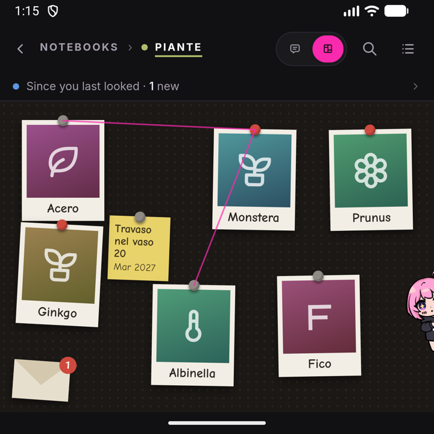

# Notebooks

Everything you say to Jenny normally lands in one continuous personal conversation. A **notebook** is the other kind: a separate conversation bound to one folder, which remembers what it is told by *writing it down* in that folder instead of by feeding Jenny's personal memory.

In the home the personal chat is the **Jenny** page; a notebook opens from the **Notebooks** page on its board, and its chat is behind Jenny — tap her over the board. In the workshop's Console you switch with the chip above the message box: it shows her name (*Jenny* unless you renamed her) when you are in the personal chat, and `wikis › <name>` when you are inside a notebook.

## What a notebook is

A notebook is a folder under `workspace/wikis/<name>/` — the same place [wikis](./wiki.md) live, because a notebook *is* a wiki. There is no separate `notebooks/` directory, and a notebook you create in the app is a wiki like any other.

<p align="center"></p>

A freshly created notebook looks like this:

```text
workspace/wikis/greenhouse/
  AGENTS.md              this notebook's own instructions (its scope, and its id)
  wiki/
    index.md             THE MAP: what this is, what is decided, what is open, which pages exist
    <one page per thing>.md
  raw/
    journal/YYYYMMDD.md  the working journal — one file per day, append-only
    research/            what arrives from outside, copied in verbatim
  log/YYYYMMDD.md        one line per operation
  audit/                 the human correction channel (see the Wiki page)
    resolved/
```

Once the notebook has a [board](./board.md), its files sit beside the rest (`raw/photos/` appears with the first photo added to a drawer):

```text
  board/
    board.json           the board: skeleton, cards and positions, your sections, threads, proposals
    cards/<id>.json      each drawer's summary, written from the wiki and regenerable
  raw/
    photos/              photos added to drawers
```

Subfolders under `wiki/` are allowed, not required. Wikis that existed before this layout keep whatever structure they already have — Jenny follows the structure it finds, and that notebook's `AGENTS.md` is the authority on how that one works.

## How a notebook differs from the personal chat

| | Personal chat | Notebook |
|---|---|---|
| Session history | `sessions/unified_default.jsonl` | `sessions/project_<name>.jsonl` — its own thread |
| Feeds long-term memory? | Yes — the [Dream](./memory.md) pipeline builds `MEMORY.md`, `USER.md`, `SOUL.md` from it | **Only `USER.md`.** It is archived into `memory/history.jsonl` under its own key, and Dream may take facts about *you* from it into `USER.md`, nothing else |
| Remembers by | Dream, between conversations | Writing facts into its own folder, during the conversation |
| Where writes may land | Anywhere in the workspace | **Only inside its own folder** |
| Reminders, cron, scheduled jobs | Yes | Only with a [board](./board.md): a job belongs to one card or to the whole notebook — Jenny decides — and delivers here (see [Notebook crons](./scheduling.md#notebook-crons)). Without a board it is refused, and Jenny points to the personal chat |
| App data | Read and write | Read yes; change only the apps placed on this notebook's board (see [Apps on a notebook's board](./mini-apps.md#apps-on-a-notebooks-board)) |
| Prompt carries | Your profile, the [list of your wikis](./memory.md#how-jenny-knows-which-wikis-you-have), and the [diary](./memory.md#the-diary-what-happened-in-your-notebooks): what was written in every notebook's journal lately | Your profile, plus **this notebook's** board (or its map) and pages — not the list of the other wikis, and nothing from another notebook |

Going in, the boundary is narrow on purpose: *who you are travels into a notebook, where else you work does not.* `SOUL.md` and `USER.md` are read from the installation root and reach a notebook's turns in full, so Jenny still knows your language, your habits and your context while working there; of `memory/MEMORY.md` a notebook gets only a one-line pointer, not the content. What does not reach a notebook is the cross-notebook inventory (the `## Wikis` block), the tail of your personal conversation, and anything from another notebook.

Coming out, the personal chat **is kept informed**, because Jenny is one person and should know what you did with her elsewhere. Every line a notebook writes into its journal also leaves a short copy in `memory/history.jsonl` — the fact, who said it, which notebook, and where the full line is — and the personal chat sees the last days of those copies in its [diary](./memory.md#the-diary-what-happened-in-your-notebooks). So if you tell a notebook you watched a film, the personal chat knows it without being told twice. It works the other way too: in the personal chat, when you mention something that belongs to one of your notebooks — the mechanic coming on Thursday for the camper — Jenny writes it into that notebook's journal herself, without you opening it. She never creates a notebook to do so, and something about you (your health, how you feel) stays out of the notebooks even when it comes up while talking about one. And when a conversation in the personal chat turns into real work on one notebook's subject, Jenny offers once to continue there: a button under her reply opens that notebook's chat, where she knows what you were in the middle of. What does not come out is the notebook's own material as knowledge: a notebook conversation is also archived into `memory/history.jsonl` under the notebook's own key, and Dream digests it in a separate batch whose only write tool is the entry tool on `USER.md`. A fact about you said inside a notebook can land in `USER.md`; the notebook's own material cannot reach `MEMORY.md` or `SOUL.md`.

The practical consequence: **a notebook is not private from Jenny, and the personal chat knows what happened in it lately** — as one-line events, not as pages. For details, Jenny opens the notebook's journal or searches with `recall_history`, which from the personal chat reads every entry in the file (inside a notebook that tool refuses). The personal chat on Telegram is the same conversation, and sees the same diary.

## Writes stay inside the folder, reads do not

Inside a notebook, Jenny may read anything in the installation — skills, other wikis, your notes, code — but may write only under `workspace/wikis/<name>/`. A write outside is refused at the tool, including a write into *another* notebook: there is no cross-notebook work.

This is enforced by the turn's own write boundary, not by a prompt asking nicely, and it survives delegation: a subagent spawned from a notebook turn gets the installation as a read-only extra and the notebook folder as its only writable root. It also applies to code — inside `python_exec`, `open(..., 'w')` and `os.remove` on a path outside the notebook are refused the same way.

## Creating a notebook

In the home, tap the round **+** on the **Notebooks** page; in the workshop's Console, tap the chip above the message box, then **New notebook...**. Two questions follow.

1. **Notebook name.** Letters, numbers, dot, dash and underscore; it must start with a letter or a digit and fit in 64 characters. No spaces and no accents — this name is a folder name *and* a conversation address, so `Greenhouse Notes` and `caffè` are refused. The rule is written under the field, and a name that breaks it keeps the dialog open with what you typed and the reason underneath, so you can fix it in place (the same goes for **Rename**). If the name already exists you get a warning rather than a refusal ("If it was left half-built I'll finish it, otherwise the creation will be refused") with a **Try anyway** button. If the name matches a conversation whose notebook folder is gone, you are asked first — "“name” still has a conversation", with the number of messages — and choose **Pick it up** to carry on in that chat or **Start clean** to throw it away.
2. **What is it about** — one line: what belongs here and what does not. This is required; without it the chat starts on nothing. It is stored as the notebook's summary and as the opening line of both `AGENTS.md` and the map, and it is capped at 500 characters.

On success you land straight in the new notebook's chat, and Jenny speaks first: a short greeting, written by the model from the name and the line you just wrote, that ends by asking where to start. If the model cannot be reached, or takes more than 15 seconds, a fixed sentence takes its place ("Hi! This is our space to talk about: …"), so the chat never opens empty. A conversation you chose to pick up is not greeted. In the home the chat opens over the notebook's [board](./board.md), which you find when you close it; the sections of its drawers are proposed by Jenny once the notebook has a few pages, or you can ask her for the ones you want while the board is still empty. The scaffolding — folders, `AGENTS.md`, an empty-but-structured `wiki/index.md`, today's `log/` entry — is written for you; nothing that already exists is overwritten, which is why re-running the creation on a half-built folder repairs it instead of clobbering it.

Later, once the notebook has some pages, `/init` inside it rewrites that notebook's `AGENTS.md` from what the folder actually contains — its scope, the conventions the pages already follow, and the open questions. Outside a notebook, `/init` refuses and tells you to open one (in the home from the **Notebooks** page; the server's text also mentions the workshop's chip above the composer, and still calls the notebook a *project*).

To **delete** a notebook, in the home press and hold its row on the **Notebooks** page (the card that opens also has **Open**, **Add as a page** and **Rename**) and choose **Delete**; in the workshop, open the chip and tap the bin on its row. Then confirm. The confirmation names how many messages of its conversation go with it, because a notebook's chat is deleted together with its folder. The workshop's file browser (Memory drawer → **The real files**) offers the same thing from the notebook's folder. (Deleting the folder by hand, or over [ssh](./ssh.md), also works but leaves the conversation behind under a name that is now free — which is why the file browser refuses that route and routes you to the notebook delete instead.)

A folder whose name breaks the naming rule is not listed as a notebook and cannot be opened as a conversation. It appears instead under a **Cannot be opened** heading — on the **Notebooks** page and in the chip's list — with a line saying why, so it does not look deleted. There is no file manager to fix it from the home: ask Jenny from the personal chat to rename it (letters, numbers, dot, dash, underscore), and it becomes a notebook.

## The switch beside the chip: Writes or Read-only

This is a workshop feature: the home has no such switch, and a message sent from the home always goes out with writes on. In the workshop's Console, next to the chip, is a two-state switch — **Writes** (pencil) and **Read-only** (eye). It applies to both kinds of conversation, and it answers one question about the message you are *about to send*: may it change anything on this device?

- **Writes** is the default. The chat can create and edit files, download, capture to a notebook's journal, schedule reminders, install an app update.
- **Read-only** means nothing on the device changes. Jenny still reads anything, still runs code that computes and reports, still answers and still messages you. What it does instead of writing is *describe* the change: which file, what would go in it, and why. That description is the deliverable, not a preamble to an attempt.

What read-only refuses, concretely: `write_file` / `edit_file` / `apply_patch`; every write route inside `python_exec` (including `open(..., 'w')`, `os.remove`, `shutil.rmtree`); downloading a file; appending to a notebook journal; adding, listing or removing scheduled jobs; changing mini-app data; installing an app update. Delegating does not lift it — a subagent runs under the same restriction. One thing stays open on purpose: `ssh_exec`, because a remote machine is a different axis from this device.

The switch is remembered **per conversation, in memory only**. Reloading the workshop starts you back in the personal chat with Writes on. The state is not held on the server: the flag rides along with each message you send, so what you saw on screen is what the turn actually got.

## Capture: the conversation is a source

This is the point of a notebook. In a notebook, with writes on (always, in the home; the **Writes** side of the switch in the workshop), anything you say that will still be true next week gets written to the journal *before* Jenny answers you.

- **Yes**: a constraint, a decision, a preference, a name, a date.
- **No**: mood, courtesies, the thread of the discussion.

The gesture is one line appended to `raw/journal/<today>.md`, timestamped:

```text
# 2026-08-24

- 09:14 — the launch date moved to the second week of October
- 09:31 — prefers the quarterly plan over the annual one
```

The journal is append-only by construction — the tool that writes it can only append, to today's file, in the notebook you are in. Nothing rewrites a line once it is there.

Two things follow from this design that surprise people:

- **Jenny does not ask permission to write.** The switch already answered that question; asking again in words would reopen what you closed. If you do not want a turn to capture, flip the workshop's switch to Read-only — in read-only the capture instructions are not even part of the prompt, so Jenny does not attempt it and does not offer.
- **Capture is not authorship.** A journal line is not a page. Turning lines into pages, and keeping the map current, happens when you ask for it — Jenny hands that to the [notebook editor](./board.md#asking-jenny) — or on its own, later, in a [gardener](./gardener.md) pass.

What arrives from outside — an article, a document, a page you pasted — goes verbatim into `raw/research/` first, and into a page second, with the page's `source:` pointing back at the raw copy.

## What Jenny actually sees: the board, the map and the pages

Two things from the notebook folder are put in front of the model on **every** turn: the board or the map, and the pages.

**The board**, when the notebook has one with at least one card, takes the map's place: one line per card — its name, its brief, its nearest reminder, and a problem flag when a mini app in its drawer is in alarm or stalled — plus how many pages are off the board, within the same **2,000 characters**. `wiki/index.md` is then not injected, but it still exists, Jenny is told it lists every page, and it still decides the order of the pages below. When your message names a card by its title, that card's whole drawer (up to 2,500 characters, at most two drawers per message) is added to that turn's context — next to the time, not in the cached system prompt, so a message that names nothing costs nothing extra. See [Notebook board](./board.md).

**The map**, in a notebook without a board (or with an empty one), is `wiki/index.md`: what the notebook is, what is decided, what is open, and which pages exist. It is injected whole up to **2,000 characters**. Past that it is not head-truncated — that would deliver the prose and drop the index, which inverts the point — so instead the list of page links is kept in the order the map names them and whatever budget is left goes to the head of the file, cut at a line boundary. A notice reports the map's true size, and `(+N more)` if even the bare list did not fit.

This is why the map must stay short when it is injected: it is paid for on every single message. When a section of it outgrows a few lines, that content belongs on its own page.

**The pages** come next, up to **6,000 characters** in total, in the order the map names them (pages the map never mentions go last, alphabetically). On real notebooks that is typically **one to four pages of twenty to fifty** — so the block states the count — *"Those are 2 of the notebook's 33 pages"* — and carries a notice naming how many were left out and reminding Jenny that `read_file` opens them.

Consequences worth knowing:

- **A page that is not there is not missing.** `read_file` opens it, and the map — or, with a board, the drawers and the count of pages off the board — tells Jenny it exists. The order is the selection, and the order comes from your map — moving a page's link higher in `wiki/index.md` is how you make it arrive first.
- **No page ever enters half.** A page that does not fit is skipped whole, and the scan moves on to the next one.
- **A page over 6,000 characters never enters a turn at all**, in any conversation in that notebook. That is what a gardener split is for; you can also split it by hand.
- **Answers should cite.** Jenny is told to name the pages it leant on, as `[[page-name]]`. An answer that cites nothing is the visible sign that a notebook is not working yet.

Damaged files degrade rather than explode: a page that cannot be read is skipped and counted among the ones left out, and a `wiki/index.md` that is not valid UTF-8 is read with replacement characters rather than discarded (throwing it away would silently change *which* pages get selected). To find such files, ask Jenny to run a wiki lint pass — its first check names every non-UTF-8 page and the offending byte.

## History, and when it gets compacted

By default a notebook's conversation is **never** compacted for sitting idle. It can sit for three weeks and pick up exactly where it was — that is a notebook's job. The personal chat behaves differently; see [Memory](./memory.md).

The fence is about *time*, not *length*. A notebook conversation that grows long enough to pressure the model's context window is still consolidated the ordinary way: the oldest slice is summarised, the summary is carried forward, and those messages stop being replayed to the model. Nothing is removed from disk on that path. The summary goes to `memory/history.jsonl` under the notebook's key, where no chat's prompt shows it and only Dream's `USER.md`-only batch reads it.

If a notebook's knowledge really does live in its pages, you can turn that fence off in the workshop's **Memory** drawer, in the **Gardener** group, under *Notebook history* → **Archive an idle notebook's chat**. Read what it costs first: after that, an idle notebook's conversation is archived like the personal one, and Jenny then has in context what was *written* in the wiki, not what was *said*. The visible transcript is untouched, so you can still read back — the amnesia is the agent's, not the record's. The setting is read when the agent starts, so it takes effect from the next gateway start.

Two gates still protect a notebook even with compaction on, and both are checked every time:

1. The journal must be **fully promoted** — if there are journal lines no gardener pass has read yet, compaction is deferred, because those lines are knowledge that has not reached a page.
2. The notebook must have **at least one page**. A notebook with no pages is never compacted, whatever its journal says: the whole premise of compacting is that the knowledge is in the pages, and there it is nowhere.

When a notebook's history *is* compacted, the messages that leave the live session are replaced by a summary, and the visible transcript still holds the whole conversation — so nothing disappears from your screen. The one path that could have lost text is covered too: if the summarising call to the provider fails, the dropped messages are written verbatim to `<notebook>/raw/compacted/<YYYYMMDD-HHMMSS>.jsonl` *before* the session is trimmed, and if even that copy cannot be written, nothing is trimmed at all and the next idle window tries again. (The failed summary is also dumped raw into `memory/history.jsonl` under the notebook's key, but no notebook prompt reads that file, which is why the notebook gets a copy of its own. On the personal chat the same failure trims nothing: the conversation stays whole and the next idle window tries again.)

## Renaming a notebook from the app

In the home, press and hold the notebook's row on the **Notebooks** page and choose **Rename**. The name follows the same rule as at creation (letters, numbers, dot, dash and underscore; the rule is written under the field and a name that breaks it keeps the dialog open). Jenny renames the folder first and then moves the conversation after it, so the chat, its history, a page you pinned for the notebook and its reminders and automations (the ones Jenny scheduled there) all follow the new name; if you were inside it, you stay inside, under the new name.

It is refused, before anything moves, in three cases, each with its own message: she is still working in that notebook (a turn, a subagent, a gardener pass or an idle compaction is writing — try again once she has finished); the new name already belongs to a notebook or a conversation; or the notebook is no longer there. If the process dies between the folder and the chat, what is left is exactly the state the next section describes, and the gateway finishes the move on its own at the next turn or start.

## If you rename a notebook's folder from outside Jenny

The folder name is the conversation's address, so renaming it — from the file browser, over ssh, from a computer — moves the address. Jenny records a stable id in each notebook's `AGENTS.md`, and uses it to chase the chat after the fact. On the next message you send to that notebook, one of these happens, and in **every** case Jenny does not read that message until the situation is resolved:

| What happened | What you see |
|---|---|
| Renamed to a valid name | Jenny says it moved the history to the new name — its scheduled automations move with it — nothing was lost, and asks you to open the new name (from **Notebooks** in the home, from the chip in the workshop). |
| Renamed to a name that cannot be a conversation (spaces, accents) | Jenny says it found the folder but left the history under the old name rather than moving it somewhere nothing could open, names the character rule, and points out that renaming it back also works. Nothing is moved. |
| The folder is simply gone | Jenny says it could not find where it went, that nothing is lost, and that the chat comes back as soon as the folder does. |
| A previous move stopped halfway | Jenny says part of the history is under each name, that nothing was deleted, and that restarting it finishes the join on the way up. This is the one case that does **not** claim "nothing is lost" in the same breath. |
| A turn of that chat is still running | Jenny defers the chase and asks you to send the message again once the previous one has finished. |

Two folders swapping names is refused rather than guessed at, and a notebook whose `AGENTS.md` carries no id cannot be chased at all — the chat is simply left behind under the old name.

## See also

- [The gardener](./gardener.md) — the background pass that turns journal lines into pages, when it runs, and how to turn it off.
- [Notebook board](./board.md) — the cards, drawers, reminders and proposals a notebook opens on.
- [Plans](./plans.md) — a big job in a notebook, proposed as steps you approve and run one at a time.
- [Wiki](./wiki.md) — reading, searching, editing a page and reporting one, which work on notebooks too.
- [Memory and Dream](./memory.md) — the personal side of remembering, and the budgets.
- [Slash commands](./slash-commands.md) — `/gardener`, `/init` and the rest.
