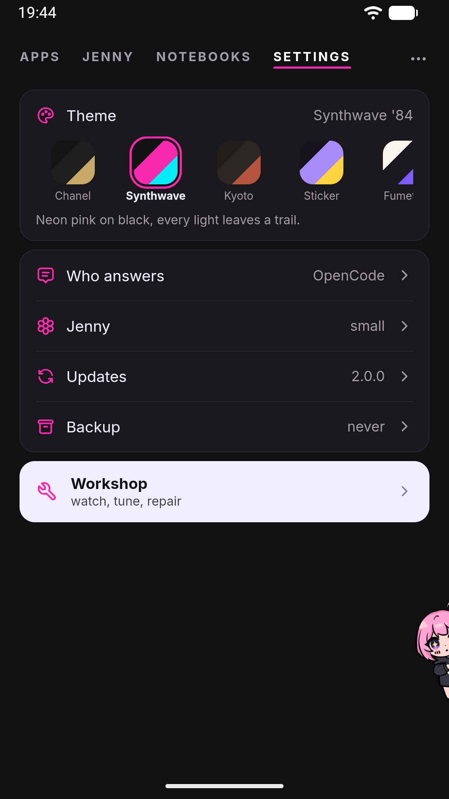

# Themes and mascot

Jenny's look (the color theme and the on-screen mascot) is personal to the phone you're using: none of it is backed up or synced.

## Themes

Open the home's **Settings** page and the first card, **Theme**, holds a row of pills: each one is a three-colour swatch (background, surface, accent) with the theme's short name. Tap a pill to switch instantly; the app doesn't ask for confirmation and there's nothing to save. The card shows the full name of the active theme and a one-line description of it.

There are seven named themes:

| Theme | Scheme | Feel |
|---|---|---|
| Chanel | Dark | Black and white couture, a thread of gold only where it counts |
| Synthwave '84 | Dark (default) | Neon pink on near-black |
| Jenny Kyoto | Dark | Earth, rust, hand-rounded edges |
| Jenny Sticker | Dark | Cut-out sticker look, white borders, hard shadows |
| Jenny Fumetto | Light | Ink on paper, comic-panel replies |
| Jenny Y2K | Light | Glossy gradients, bubblegum gloss |
| Jenny Pietra | Light | Travertine, bronze, Roman serifs |

Synthwave '84 is what a fresh install starts with. Whichever theme you pick, the app applies it before the very first paint on later launches, so there's no flash of the wrong colors.

On Android, the status bar and navigation bar follow your theme automatically — their background color and icon color (light or dark) are kept in sync with whichever theme is active, so a light theme like Jenny Pietra gets dark system-bar icons and a dark theme like Synthwave '84 gets light ones. This only happens inside the Jenny app itself; if you ever open the WebUI in a regular desktop or mobile browser instead of the Android app, the system bars obviously stay whatever your browser or OS already uses.

Your theme choice lives in the WebView's local storage on this specific device, not in `config.json`. That has two consequences worth knowing up front:

- It does **not** travel with an [encrypted backup](backup.md) — a `.jbk` file restores your conversations, memory, and settings, but not which theme card you last tapped.
- Reinstalling the app, or clearing the app's storage, resets the theme back to Synthwave '84. This is expected, not a bug.

## Mascot

A small companion (Jenny, styled as "✿") follows the conversation from the corner of the screen, and she is **the door to the chat**. On the home's chat page, and in the workshop's Console, the chat is already there: a tap on her makes her wave — she winds up, hops raising her arm and waves three times. While she is thinking or talking a raised arm would say something she isn't doing, so then she only hops. Everywhere else — the home's other pages (Apps, Notebooks, Settings), the rooms opened from them, a notebook's board, a mini-app, and every view of the workshop except the Console — she lives docked at the edge: tap her, or swipe her inward from the edge, and **the real chat comes up full screen over what you are looking at**. The page stays beneath it, blurred behind a veil so that its colours show through while the chat stays readable, but it can't be touched; tap her again, or press Back, and the chat goes away and the page is where you left it.

A few things about that chat are worth knowing before you rely on it:

- It is **the same chat** as the chat page: history, attachments, the Stop button, everything. Over a notebook's board, its card drawers and its pages it is that notebook's conversation (the message box says "…, in the notebook"); everywhere else it is your personal conversation.
- Jenny can see **the page under the chat**. She has a pull-based tool that fetches what is on screen when she decides it's relevant, and with the chat open over a page it describes that page, not the chat — so "what does this setting do?" asked over the Settings page, or over the workshop's Brain, is answered about what you are looking at.
- If a reply arrives while the chat is closed, a **pink dot** appears on her head: tap her to read it. It lights for the conversation she would open from where you are.
- She can't be switched off: since she is the way into the chat, a door that disappears would leave the chat unreachable.

While waiting for a reply she switches between a "thinking" pose and, once text starts streaming back, a "talking" pose with an animated mouth. If you leave her alone reading a long reply she quiets back down into "thinking" after about a second of no new text.

Every move of hers squashes and stretches, the way a cartoon character's body does: at rest she breathes, thinking she sways, talking she stretches a hair on each syllable, and coming out from the edge she leans into the slide. The deformation always stays on the drawing's own axes, so she never looks sheared, and at the docked edge — where only half of her shows — the talking and the moods leave her body still.

Once a reply is done she reacts to it for 12 seconds: **happy, sad or angry**. The reaction comes from the emoji she wrote in that reply — her own signature four, 😏 😈 💅 🤭 (the ones her character sheet gives her), or any of the smiles and hearts, make her happy, a 😔 or a 💔 sad, a 😤 or a 😒 angry. When a reply mixes them, the most frequent wins, and on a tie the last one: the tone of a reply is at its end. Emoji inside code or in quoted lines don't count, and neither do ambiguous ones (🤔, 😅, or her own 🙄 and 😭, which are tone rather than mood) or things that aren't feelings (☀️, 🍝) — a reply without an emotional emoji shows no face at all. Nothing is asked of the model, so it costs nothing and works with any model and in any language. Errors make her sad on their own. She reacts *after* speaking, never while, and the face arrives with a body reaction: a hop when happy, a droop when sad, a stamp when angry. `agents.defaults.mascotMood` in `config.json` turns it off — see [Configuration](../reference/configuration.md).

Her face and her body are two separate drawings stacked on each other, which is why an expression can ride on top of any pose rather than being a pose of its own. It works at the docked edge too, where she is seen from the side: the same happy, sad and angry faces are drawn in profile, over her side pose.

Drag her instead of tapping and she takes flight: she hangs from your finger with a bit of pendulum physics, and on release falls, bounces, gets up, and walks back home to her docked position. Hanging she stretches as much as you yank her, in the air she stretches with her speed, the thud squashes her as hard as she landed, and each step dips on the change of foot. It's a pure fidget interaction with no functional effect — dragging her doesn't send anything or change any setting.

Her preferences are on the home's **Settings** page, in the row named after her (**Jenny** unless you gave her another name):

| Setting | Options | Default |
|---|---|---|
| Mascot size | Small / Medium / Large | Small |
| Floating mascot | on / off (Android only) | Off |

The same screen holds **Her name** (up to 40 characters). The Settings row, the chat page and the other places that name her follow it, and changing it erases nothing she remembers. Under the mascot settings sits **The rules you gave her**: a text of yours, up to 2,000 characters, that she reads every turn and never rewrites — Dream included. Both have their own **Save** button.

**Floating mascot** puts her in a window above other apps: tap her there to talk, and the answer comes in a bubble, in the same conversation as the app. It needs Android's "Display over other apps" permission, and the page tells you when that is missing.

Size is the side of the square she occupies — 120, 160 or 210 px; she starts small. The rest of her geometry follows from it, so she stays coherent at every size.

Which edge she docks on is not a setting: she always docks on the right, and after a throw she walks back there.

She comes in one look, in color. There used to be a black-and-white switch here, drawn from a second set of line-art artwork; it was retired when her expressions were drawn, because keeping both meant drawing every expression twice.

Like the theme, **Mascot size** is stored in this device's local storage, not in `config.json` and not in your encrypted backup. A reinstall brings her back small. **Floating mascot** is the exception: it lives in `config.json` (`floating.enabled`), because the window is started by the app's background service, which can't read the WebView's storage.

If your phone has "reduce motion" turned on at the OS level, Jenny respects it: the animated mouth-flap while she talks is skipped in favor of a static pose, and her gestures stand still: no hops, sways or squashes, and the wave shows as a raised arm for the length of a wave. The drag-to-fly gesture itself is a direct manipulation you control with your finger, so it still works if you choose to use it, without the squash and stretch.

## UI language

The interface exists in two languages: Italian and English. It follows the phone's system language, checking an exact match first and then just the language prefix; for any other language it falls back to English. There is no language switch inside the app: to change it, change the phone's language.

This is worth separating clearly from a similarly named setting:

- **UI language** only controls what the buttons, labels, and toasts in the WebUI say.
- **`agents.defaults.language`** is a `config.json` field, and the *only* place that writes it is the onboarding wizard. It captures the UI language active when you set the phone up, and uses it for the text the backend writes to you: the initial welcome message, provider errors, notification titles and slash-command replies.

Changing the phone's language later does **not** touch `agents.defaults.language`. Any backend-generated text that depends on that field keeps using the language you had during onboarding until you edit `config.json` directly; see [Configuration](../reference/configuration.md). Several backend error messages (settings validation, some model-list failures) are in English regardless of either.

None of this affects what language Jenny actually *replies* to you in during a normal conversation: that depends on the language model you're using and how you write to it, not on any setting in this app.

## See also

- [Settings](../reference/settings.md): where this page's controls live.
- [Chat basics](chat.md) — how the main conversation renders.
- [Backup and restore](backup.md) — what does and doesn't travel in a `.jbk` file.
- [Configuration](../reference/configuration.md) — `config.json` reference, including `agents.defaults.language`.
