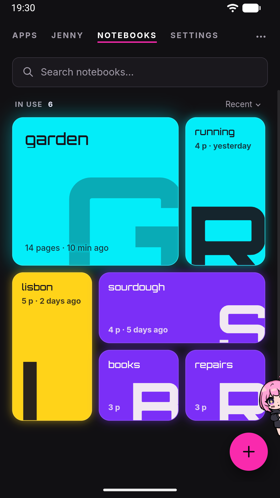
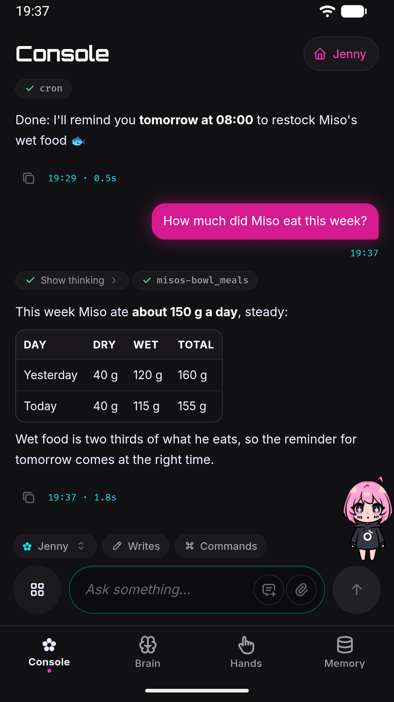

# Tour of the WebUI

Jenny's interface is a mobile web app (a "WebUI") running inside the Android app, and it comes in two parts. The **home** is what opens: a row of pages you swipe between, the way any launcher works, with the conversation in the middle. The **workshop** is the other half — the full console with Jenny's thoughts, tool calls and timings, and every setting — and you reach it from the home's Settings page. This page is a map of both: how you move around, what the Android back button does, and where each thing lives.

## The home

### The pages

The home is a row of pages, and their names run along the top of the screen: the page you are on is brighter, and underlined in the theme's accent colour. Tap a name to jump to it, or swipe sideways anywhere on the page. Four pages are always there:

| Page | What it is |
|---|---|
| **Apps** | The app drawer: your Android apps and your [mini-apps](mini-apps.md), with a search box and the ones you use most at the top. See [App launcher](app-launcher.md). |
| **Jenny** | The personal conversation, always. The page carries her name — *Jenny* unless you gave her another one (see Settings below) — and it never changes into a notebook. See [Chat basics](chat.md). |
| **Notebooks** | Who you are talking to: the personal conversation and every notebook, with a check mark on the one you are in. Tap the personal row and you are on the **Jenny** page; tap a notebook and it opens right there, with its own chat; the round **+** makes a new one; press and hold a row for **Open**, **Add as a page**, **Rename** and **Delete**. See [Notebooks](projects.md). |
| **Settings** | The settings of whoever uses the phone — theme, who answers, Jenny herself, updates, backup — and, at the bottom, the door to the workshop. |

The home always opens on **Jenny**. Beside the four you can keep up to eight pages of your own: press and hold a mini-app in the drawer, or a notebook in **Notebooks**, and choose **Add as a page**. A mini-app that opens outside Jenny, or one that is broken, shows that row greyed out with the reason. A notebook page is a door: landing on it opens that notebook's board, and Back from the board brings you to the chat page.

Every page can be moved, the four fixed ones included: press and hold a name at the top, drag the names into the order you want, and tap **Done**. The pages you added carry a **×** to remove them; the fixed four cannot be removed. Back leaves that mode without saving. The order and the pages you added are stored in `config.json` — see [`home` in Configuration](../reference/configuration.md#home).

### The conversation

The **Jenny** page is the chat, kept deliberately plain: your messages, her answers, and a composer with a paperclip for [attachments](attachments.md), the text box and a send button. There is no Commands chip, no scope chip and no Writes/Read-only switch here — those belong to the workshop's Console. Slash commands are typed by hand (see [Slash commands](slash-commands.md)), and a message from the home always goes out with writes on.

- **While she works**, a single line under the conversation says what she is doing, in a word from the family of the tools actually running (reading, searching, writing, going out, running code, delegating), or that she is thinking before the first tool starts. It appears only if the turn lasts more than half a second and steps aside while her answer is being written. **Press and hold that line** to open the same turn in the workshop, with every thought and tool call.
- **While agents work for her**, a small chip above the composer says so — *Working · plant cards*, or *2 agents working* — and turns to the warning colour if one is stuck. Jenny does not keep the turn open while they work: she tells you the job started, the turn ends, and the result arrives later as a message of its own. The chip belongs to the conversation the agents work for, so a notebook shows its own and the personal chat its own, and it disappears when they finish. It only says *that* they are working: **press and hold it** to see them in the workshop's [Subagents strip](#the-subagents-strip), with times, steps and **Stop**.
- **While a turn is running**, the send button becomes **Stop**, which sends `/stop` — see [Slash commands](slash-commands.md).
- **If the connection to the gateway drops** for more than a couple of seconds, a line says *Connection lost, retrying*; it goes away on its own when the socket is back. It is about the link between the WebUI and the gateway inside the same app, not about your internet connection.
- **Messages that came from elsewhere** — Telegram, a notification you answered from the shade, the floating bubble — carry a small label saying where they came from. You can answer from the shade too: the notification has a **Reply** field, and if that reply cannot be delivered it offers **Send again**. The floating mascot's bubble has a **Continue in the app** button that opens the app on the conversation.

Tap a notebook in **Notebooks** and it opens on its [board](board.md), under the header row **← Notebooks › name**: a card per subject, sticky notes for reminders, threads between cards, and an envelope with Jenny's proposals; a lens in the header searches the whole notebook and a list icon shows the cards as a list. Tapping a card opens its drawer, a short summary with links to the wiki pages it was written from. Tapping a page opens it in a reader, where **Edit** opens a plain text editor with **Save** and **Cancel** at the bottom, and selecting a piece of text offers **Report**, which sends Jenny that passage with your note on what is wrong. The notebook's chat is behind Jenny: tap her on the board, a drawer or a page and its conversation comes up over it, with the board still visible beneath; tap her again or press Back to go back to the board. See [Notebook board](board.md) and [Wiki](wiki.md).

### Settings

The **Settings** page is short on purpose, and every row shows its current value on the right:

| Row | Opens |
|---|---|
| **Theme** | A card on the page itself: pick a theme and see it applied at once. See [Themes and mascot](themes-mascot.md). |
| **Who answers** | The configured providers, the key of the one you are looking at, and its models. Tapping a model is what switches — provider and model together. |
| **Jenny** (her name) | **Her name** (the row and the page are titled with whatever you chose), whether the mascot is shown and how big, the floating mascot over other apps (on Android), and **The rules you gave her**: a text of yours that she reads every turn and never rewrites. |
| **Updates** | Whether the update check works, what is available, and the install. See [Updates](#updates). |
| **Backup** | When you last exported a backup, export and restore, and a note on the local workspace history. See [Backup](backup.md). |

Below them, **Workshop — watch, tune, repair** opens the workshop.

### Updates

Jenny checks for a new version by herself about once a day (`updates.checkIntervalH`, default 24 hours) and, when there is one, says so once in the chat. **Settings → Updates** shows the version you are on, whether a newer one is out and what changed, when the last successful check happened, and a **Check now** button that asks the update server right away. A check that keeps failing to reach the server is called out there in words, because otherwise you would simply never hear about a new version.

**Install now** downloads the update and hands it to Android, and the last step is always yours: Android asks you to confirm before it replaces the app. If you cannot see that prompt, it also arrives as a notification ("Update ready to install"); if you dismissed it, press **Install now** again. Once you confirm, Jenny restarts on her own and the connection drops and returns by itself.

The `updates.enabled` setting in `config.json` switches off only the periodic check; **Check now** and the install work regardless. See [`updates` in Configuration](../reference/configuration.md#updates).

### The back button and Home

Jenny is also set up as an Android launcher (see [Set it as your launcher](../start/launcher-setup.md)), so back never closes the app. One press undoes one thing, from the top:

1. an open dialog (a confirmation, the backup passphrase), an open sheet (the one a long press opens, or the board's: *since you last looked*, the envelope, search, a page preview, *Add a section*), an enlarged image, the chat opened over the page by tapping Jenny, a mini-app opened from the drawer — which first goes back inside itself if it has its own screens — the page-ordering mode, a search typed in the drawer, the Report sheet;
2. then the rooms, one per press: the page reader goes back to the drawer it was opened from (or to the board, if you opened the page from search), a drawer goes back to the board, the board goes back to the notebook's chat, a room opened from Settings goes back to Settings;
3. then, on the Notebooks page with a notebook open, back closes the notebook and returns to the list of notebooks;
4. then, from any page other than the chat, back returns to the chat, wherever it sits in the row.

On the chat page with nothing on top, back does **nothing**: there is no home screen underneath to fall back to. The Home button closes whatever is open and brings you back to the personal conversation.

## The workshop

The workshop is the full interface: the console with everything under a turn on show, and every setting the home leaves out. Open it from **Settings → Workshop**, or from the work line in the chat with a long press. The Console and each drawer carry a **Jenny** pill in their header that takes you back home.

### The tab dock

A row of four icons, each with its name under it, pinned to the bottom of the screen switches between the workshop's views, in this order:

| Icon | Tab | What it is |
|---|---|---|
| ✿ | **Console** | The conversation with Jenny, with everything under it on show: thoughts, tool calls, timings. See [Chat basics](chat.md). |
| brain | **Brain** | Which brands exist, which model she thinks with (each brand holds its models, and a tap on one switches to it), the generation parameters, what the phone lets her do while the screen is off, and the app version with the token usage. |
| hand | **Hands** | What she can do and with which permissions — web search, location, SSH, Telegram, skills — and the jobs that start by themselves. |
| database | **Memory** | What she remembers: the three memory files and their caps, Dream that fills them, the gardener that fills the notebooks, the workspace files, the local snapshot history. |

The first-run wizard is not part of the workshop: it is a page of its own that both the home and the workshop send you to while no provider is configured, and it has no dock to wander off through. See [First run](../start/first-run.md).

Tapping a dock icon switches views immediately; the active tab is highlighted. Brain, Hands and Memory are three drawers of one screen — they share a controller, so moving between them does not reload anything. The app drawer opens from the grid button at the left of the Console's message box.

### Horizontal swipe

You can also switch tabs by swiping left/right anywhere in the main content area — the current view slides out and the neighboring tab slides in, with a light "peek" effect while you drag, and it snaps back if you don't drag far enough (22% of the screen width, at least 60 px, or a quick enough flick).

A few guards keep this from fighting with normal scrolling:

- If the content under your finger can scroll horizontally (a wide code block, a horizontally scrollable list), that content gets the gesture instead of the tab swipe — even when it is already at its edge.
- A mostly-vertical drag is treated as ordinary scrolling, not a tab change.
- Swipe only moves between the four dock tabs in the table above, in dock order.

### The back button

Back in the workshop follows the same rule as at home — one press, one thing: inside a mini-app it first goes back within the mini-app, then closes it; outside, it replays the in-app navigation history (for example, out of a settings sub-view). With nothing left, back does nothing.

### The identity row and connection status

The Console has a title bar of its own, **Console** with the **Jenny** pill that takes you home. Under it there's an identity row, "✿" followed by her name ("Jenny" unless you renamed her), with a small status dot next to it. This row is **not a fixed header** — it's the first item in the scrollable message list, so once you scroll up into your conversation history it scrolls away with everything else.

The dot reflects only the state of the WebSocket connection between the WebUI and the local gateway — it says nothing about your phone's internet connection:

| Dot | Label | Meaning |
|---|---|---|
| Gray | *(no label)* | No connection attempt has completed yet (just after opening) |
| Green | `online` | The WebUI is connected to the gateway |
| Red | `offline` | The socket has dropped |

Reconnection is automatic and has no attempt limit, in the workshop and at home alike: the app retries with a growing delay starting at 3 seconds and multiplying by 1.5 each time, capped at 30 seconds. Two things force an immediate retry: bringing the app back to the foreground, and the device regaining network connectivity. In practice "offline" is often just Android briefly suspending the app or the WebView (e.g., screen off) — it clears itself.

Tapping anywhere on the identity row opens the **Session Info** popover.

### The Session Info popover

Close it with the X in its corner, by tapping anywhere outside it, or with back (the **Esc** key does the same on a physical keyboard).

| Row | Value | Meaning |
|---|---|---|
| **Session** | `websocket:default`, or `project:<name>` | The key of the conversation that's open: `websocket:default` for the personal one, `project:<name>` for a notebook. |
| **Channel** | `websocket` or `project` | The first part of that key. It stays `websocket` in the personal conversation even for turns that came in from Telegram — see [Telegram bridge](telegram.md). |
| **Model** | provider / model | The model answering now, colored with its provider's brand. It is filled from the gateway when the page loads and updated live when the model is switched. |
| **Preset** | a preset name | Shown only when a model preset is active. |
| **Notebook** | an absolute path | The workspace folder the agent reads and writes files in (Jenny's private storage on the device, not shared phone storage). |
| **Access** | a badge with a lock icon | Whether the agent's file tools are confined to that folder — see below. |
| **Status** | `Running` or `Idle` | Whether a turn is being processed, with a live timer if so — see below. |

**Access.** The badge reflects the `security.restrictToWorkspace` config setting (default `true`): **Restricted** means the file tools are confined inside the Notebook folder, **Full access** that they can also reach outside it. **Default** is a transient placeholder shown only until the chat history has loaded. There is no toggle for this in the app — it is set only in `config.json` — and the restriction is enforced by Jenny's own code, not by an Android sandbox. See [Security model](../internals/security-model.md). Notebook and Access are read when the chat history loads, so a config change shows after a reload.

**Status.** While a turn runs, Status shows **Running** with a spinner and an elapsed-time counter. The timer is backed by the turn's start time on the gateway, so it survives reloading the page mid-turn. It reflects every turn of the personal conversation, a turn started from Telegram included, since its messages appear in the same unified chat. Internal work (a reminder, a monitor, Dream) does not turn it on.

### The Subagents strip

One more piece of the Console lives outside the message list: a **Subagents** strip pinned just above the message box. It appears on its own when background work starts and vanishes when the work is done, so most of the time you won't see it. The home shows only a chip saying that agents are working (see [The conversation](#the-conversation)); this strip is where the detail is.

It exists because Jenny delegates by default: the real work often happens in subagents, and without this the chat would be silent for minutes. Collapsed, it is a single header line with a running count; expanded, it's one card per job with its type, elapsed and idle time, current step, and a **Stop** button — plus a detail sheet with the full task and a live activity stream. It is not a history view: only work from the current turn is shown. Full behavior in [Chat basics](chat.md#the-subagents-panel).

## Where to go next

- [Chat basics](chat.md) — sending messages, reading a response, the Subagents panel, `/stop`.
- [Notebooks](projects.md) and [Wiki](wiki.md) — notebooks, their conversation and their pages.
- [Slash commands](slash-commands.md) — the full command list.
- [Settings](../reference/settings.md) — every setting, including the ones only the workshop shows.
- [Security model](../internals/security-model.md) — what "Restricted" access actually enforces.
