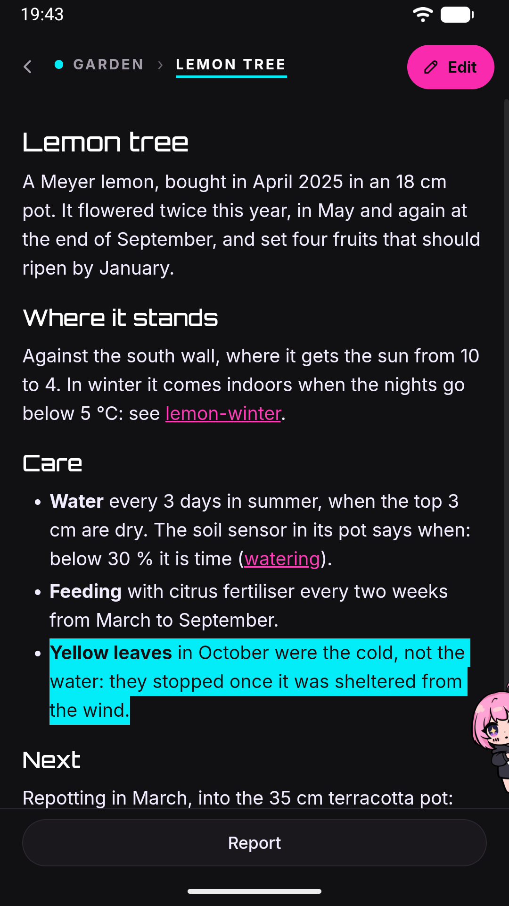

# Wiki

A wiki — a **notebook**, in the app — is a browsable knowledge base that Jenny builds for you out of sources you feed it, not something you write by hand from scratch. You reach it through the conversation it belongs to: there is no separate tab for it.

## What it is

A wiki, here, is a set of cross-linked Markdown pages that Jenny compiles from raw material — articles, notes, PDFs, web pages — into concept and entity pages that reference each other with `[[wikilinks]]`. Jenny builds and maintains it using a built-in skill called `llm-wiki`, which you invoke conversationally rather than through any dedicated button:

- "Create a wiki about X" — scaffolds a new one.
- "Ingest this article/PDF/page into the X wiki" — adds a raw source.
- "Compile the notes I gave you into pages" — turns raw material into wiki pages.
- "What does the wiki say about Y?" — answers a question from what's already compiled.
- "Run a lint pass on the wiki" — checks for dead links, orphan pages, and coverage gaps.

There is no in-app "new wiki" form: everything starts as a chat request.

**The wiki does not update itself.** Ingesting a source doesn't automatically compile it into pages, and pages don't automatically get relinted after you edit them — each of those steps only happens when you (or a scheduled task you've set up) explicitly asks Jenny to do it.

The one thing that *does* happen on its own is the reverse direction: the personal chat's system prompt lists every wiki you have — name and one-line scope, read from disk on every turn — so Jenny knows a wiki exists and what it is about before she opens it. See [How Jenny knows which wikis you have](./memory.md#how-jenny-knows-which-wikis-you-have).

## Wikis and notebooks

Everything on this page describes a wiki as something you *ask* Jenny to build and maintain. There is a second way to work with one: open it as a **[notebook](./projects.md)** from the **Notebooks** page. A notebook is a wiki — the same folder, the same pages, the same links — but the conversation is bound to it, it opens on a [board](./board.md) of the subjects it keeps coming back to, its board (or its map) and pages are put in front of Jenny on every turn, facts you mention are captured into a journal inside it, and a background pass (the [gardener](./gardener.md)) turns those journal lines into pages between conversations.

So the two views are not alternatives: a wiki you created by asking can be opened as a notebook tomorrow, and a notebook you created in the app is immediately a wiki you can ask Jenny about.

## Multiple wikis

You can have more than one wiki side by side — for example, one about a research topic and a separate one for a hobby project. Each one lives under `workspace/wikis/<name>/`, entirely isolated from the others; Jenny works on one wiki root at a time and won't mix content across them unless you ask it to. A top-level `wikis/_index.md` file lists all of them.

Because everything is plain Markdown under the workspace, wiki pages are files like any other: you can open and edit them from the file manager as well as from the page itself (see [Tour of the WebUI](webui-tour.md)), and they're included in [backups and snapshots](backup.md) exactly like the rest of your workspace.

## Opening a notebook

A wiki is reached through the notebook that belongs to it, not from a tab of
its own. Open the **Notebooks** page and tap the notebook: it opens on its
[board](./board.md), under the header row **← Notebooks › name**. A notebook you
pinned as a page of its own opens its board when you land on that page. The
notebook's chat is behind Jenny: tap her over the board to talk in it.

The board is how you reach the pages now. Each card on it opens a **drawer** — a
short summary of one subject with links to the pages it was written from — and
every page chip in a drawer opens that page in the reader. The notebook's page
list and its graph **map** are gone: the board replaced both. See
[Notebook board](./board.md).

### Searching

The **lens** in the board's header searches the whole notebook, including pages
that are in no drawer. It searches **page contents**, not just titles, as you
type. The last word matches by prefix, so results narrow letter by letter.

- Accents are optional — typing `citta` finds "Città".
- Page titles, file paths, headings and frontmatter tags all count, and a hit in
  a title ranks above one buried in a paragraph.
- Very common words are ignored rather than treated as a failed search.

Card names are matched too, and each result says where it lives: a card, the
drawer a page is in, or **not on the board**. A page off the board opens as a
short preview with **I want it on the board**.

Search runs entirely on-device: the index is rebuilt only when a page actually
changes, so typing never waits on anything.

### Reading a page

The page is rendered from its Markdown, with `[[wikilinks]]` clickable. A link
that leaves the notebook is not pretended to be openable — it says so instead.

In a notebook with a board, links are shown through the board: a link to a page
in the same drawer opens it in place, a link to a page in another drawer carries
a chip with that card's name and opens its drawer, and a dotted link to a page
that is on no card opens a short preview. Back from a page returns to the drawer
you opened it from. See [Pages, from a drawer](./board.md#pages-from-a-drawer).

Mermaid diagrams are the one place in Jenny's UI where they render as diagrams:
a fenced ` ```mermaid ` block in a wiki page is drawn. Chat replies do not render
Mermaid at all — see [Chat basics](chat.md). LaTeX renders here too, including
`$inline$` maths, which chat deliberately leaves alone (there a `$` is a price).

## Fixing a page yourself

The pencil in the header opens the page's Markdown source in a plain text box.
Save, and the page reloads from the server — what you see afterwards is the
server's rendering of what you wrote, not a guess.

**Jenny writes these pages too**, so the save carries the text you started from.
If the file changed underneath while you had the editor open, nothing is written
and you are told: reload and lose what you typed, or keep it and sort it out.
Leaving the editor with unsaved changes asks first.

## Telling Jenny something is wrong

Editing is for things you can fix. When a page is wrong on the substance — and
the fix means going back to the source, not rewording a line — select the passage
and use **Report**.

<p align="center"></p>

1. Select a stretch of text in a page. A **Report** bar appears at the bottom.
2. Tap it, and write what is wrong in your own words.
3. Confirm. Two things happen at once: an audit file is written next to the
   notebook's pages, anchored to the exact passage, and you land in that
   notebook's chat with the message already sent.

So a report is not filed and forgotten — it starts a conversation, and Jenny
answers there, where she has the files and the wiki skill. The audit file is the
durable half: it survives the conversation, the linter checks it, and it is what
lets her mark the thing as done afterwards.

If the selected text can't be found exactly once in the page's source — because
it spans formatting, or because that phrase appears twice — you are told, rather
than the comment being anchored to a guess.

Audits carry no priority. There used to be a four-level severity picker, and it
was removed: grading your own complaint is a triage step, and triage is
something a team does. Jenny works them oldest first.

There is no list of open reports in the app. Each one has a conversation you can
scroll back to, and processing them is Jenny's job, not a screen.

## Privacy notes

- The wiki only shows a small, fixed set of page metadata to the UI: title, type, entity type, tags, and created/updated dates. Anything else in a page's frontmatter — including source URLs and provenance notes Jenny records internally — stays server-side and out of the interface, even though it's present in the raw file — which the page's own editor shows you in full.
- Every ingested source keeps a `summaries/` folder of per-source digest pages. These are deliberately kept out of search and off the board to avoid cluttering navigation, but they are **not** encrypted or otherwise access-controlled — the pages are still readable if you know (or Jenny gives you) a direct link, and they still live as plain files in your workspace.

## Turning it off

A config key, `wiki.enabled` (default `true`), can disable the wiki backend entirely; when it's off, wiki API calls fail. There is no toggle for this in Settings — it's config.json-only, see [Configuration reference](../reference/configuration.md).

With it off, the notebook list still shows what is on disk, and opening a
notebook's board reports that the wiki is switched off rather than failing
silently.

## See also

- [Notebooks](projects.md) — opening a wiki as a conversation: capture, what Jenny sees, and the write boundary.
- [Notebook board](board.md) — the cards, drawers, reminders and proposals a notebook opens on.
- [The gardener](gardener.md) — the pass that maintains a notebook's pages on its own.
- [Tour of the WebUI](webui-tour.md) — overall navigation: the home's pages, and the workshop's dock.
- [Backup and restore](backup.md) — wiki content is part of your regular workspace backup.
- [Phone app launcher](app-launcher.md) — the app drawer, and the Apps page it lives on.
